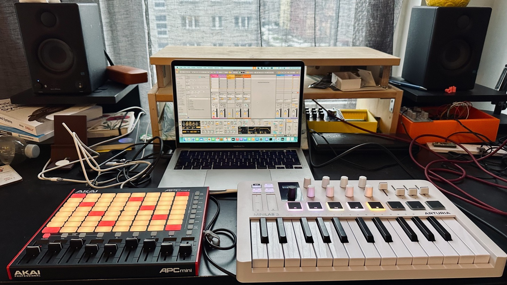
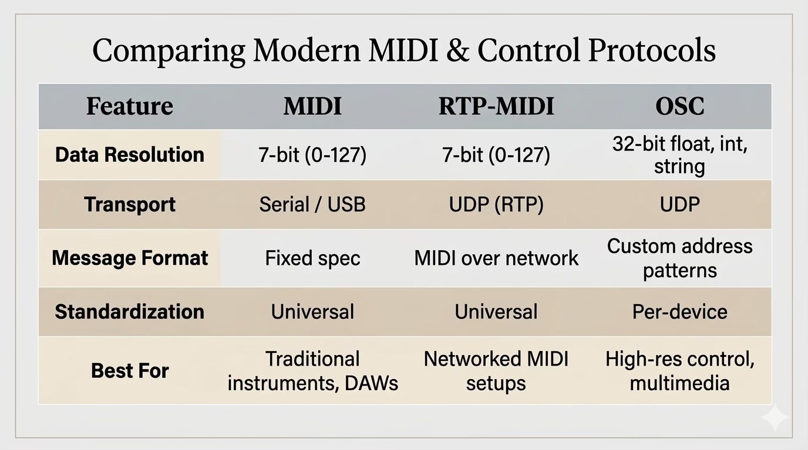

If you’ve followed my blog, you know I keep coming back to MIDI. I’ve used it to [script Ableton Live with Node.js](midi-scripting-ableton-nodejs.md), turn [Google Sheets into a music sequencer](making-music-with-google-sheets.md), [build a hardware sequencer with ESP32](making-sequencer-esp32.md), and even [won Anthropic’s hackathon](winning-anthropic-hackathon-conductr.md) with a project that sends MIDI to synthesizers. Every time I share these projects, someone asks: “What exactly is MIDI?”

So here it is. I’ll cover three protocols that move musical data around: MIDI, RTP-MIDI, and OpenSoundControl (OSC). If you’re a developer who has never touched music tech, don’t worry. I’ll use analogies from the world you already know.



### MIDI: The HTTP of Musical Instruments

MIDI stands for Musical Instrument Digital Interface. It was born in 1983 because instrument manufacturers needed a standard way for their products to talk to each other. Think of it like HTTP for music. Just as HTTP doesn’t carry the actual webpage rendering but carries requests and responses, MIDI doesn’t carry audio. It carries instructions: “play this note,” “stop that note,” “change the volume.”

A MIDI message is basically a small structured payload, like a JSON object. For example, a Note On message contains three pieces of information: the channel (which instrument should respond), the note number (which pitch to play), and velocity (how hard you hit the key). It looks something like this *conceptually*:

```
{ “status”: “note_on”, “channel”: 1, “note”: 60, “velocity”: 100 }
```

But the actual MIDI message that travels over the wire is just three bytes:

```
090 0x3C 0x64
```

The first byte `0x90` combines the status (Note On = `0x9`) and the channel (0) into a single byte. The second byte `0x3C` is the note number 60 (middle C) in hexadecimal. The third byte `0x64` is the velocity 100. That’s it. Three bytes to say “play middle C on channel 1 at velocity 100.”

There are some important limitations to know. MIDI uses 7-bit values, so everything is in the range of 0 to 127. That gives you 128 possible values for pitch, volume, and any other parameter. It also runs at [31.25 kbaud over a serial connection](https://en.wikipedia.org/wiki/MIDI#Technical_specifications), which was fine in 1983 but feels slow today. You get 16 channels maximum per connection, and the original spec is one-directional, so the sender can’t know if the receiver actually got the message.

Despite these constraints, MIDI is everywhere. Every DAW, every keyboard, every synthesizer speaks it. It’s the lingua franca of music technology, and it has survived over 40 years because it’s simple and it works.

### RTP-MIDI: MIDI Over the Network

If MIDI is like a serial port connection between two devices, RTP-MIDI is like wrapping that same data in UDP packets and sending it over a network. The official name is “RTP Payload Format for MIDI” and it does exactly what it sounds like: it takes standard MIDI messages and transports them using the Real-time Transport Protocol (RTP).

Why would you want this? Imagine you have a keyboard on one side of a studio and a computer on the other side. With traditional MIDI, you need a physical cable. With RTP-MIDI, both devices just need to be on the same network. You can even send MIDI data over the internet if you want to jam with someone in another country, though latency becomes a challenge.

RTP-MIDI adds some nice features on top of regular MIDI. It includes timestamps for each message, so the receiving side can compensate for network jitter and play notes at the right time. It also has a journaling system that helps recover lost packets. Think of it like adding reliability on top of UDP, similar to how WebRTC handles real-time communication in browsers.

Apple pioneered the implementation and built it directly into macOS. If you have a Mac, you can open the “Audio MIDI Setup” app, find the network configuration, and start sending MIDI over your local network right away. Linux and Windows have third-party implementations available too.

### OpenSoundControl: The Flexible Alternative

If MIDI is like a REST API with fixed endpoints and strict data types, OSC (OpenSoundControl) is more like GraphQL. It’s flexible, custom-structured, and high-resolution.

OSC was designed in the late 1990s at UC Berkeley as a modern alternative to MIDI. Instead of fixed 7-bit values, OSC supports full 32-bit floats, integers, strings, and even binary blobs. Instead of numbered channels and predefined message types, OSC uses human-readable URL-like address patterns. For example:

```
/synth/filter/cutoff 0.75
/drum/kick/trigger 1
/mixer/channel/1/volume 0.85
```

This looks a lot like REST API routes, right? That’s intentional. The address space is hierarchical and completely user-defined. You can create whatever structure makes sense for your application.

OSC runs over UDP by default, so it’s fast. There’s no 31.25 kbaud limit. You can send thousands of messages per second with floating-point precision. This makes it popular for interactive installations, VJ software, game audio engines, and any situation where you need high-resolution control data.

The trade-off? There’s no standardized message set. With MIDI, every device agrees that message 144 means “Note On.” With OSC, one synthesizer might use `/note/on` while another uses `/voice/trigger`. You need to check the documentation for each device or software. It’s the freedom-versus-fragmentation problem that developers know well.

### When to Use What



Use **MIDI** when you’re working with standard music hardware and software. It’s supported everywhere, and the ecosystem is massive. If you’re building a web app that talks to instruments, the [Web MIDI API](https://developer.mozilla.org/en-US/docs/Web/API/Web_MIDI_API) is your friend.

Use **RTP-MIDI** when you need MIDI but the devices aren’t physically close, or when you want wireless connectivity without losing compatibility with existing MIDI software.

Use **OSC** when you need more precision than 0-127, when you’re building interactive installations, or when you want to define your own control protocol. It’s also great for communication between different software on the same machine.

### Wrapping Up

These three protocols cover most of what moves musical and multimedia control data around today. MIDI is the old reliable standard that refuses to die (and, it shouldn’t). RTP-MIDI takes that standard and frees it from cables. OSC throws out the old constraints and gives you a blank canvas.

If you’re a developer curious about music tech, I’d suggest starting with MIDI and the Web MIDI API. It’s the fastest path from “I write code” to “I’m controlling a synthesizer from my browser.”
